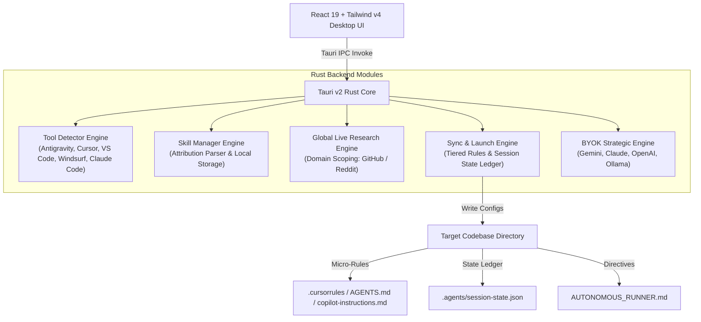

# OmniOrchestrator (Agent Orchestrator)

<p align="center">
  
</p>

<p align="center">
  <strong>The Open-Source, Local-First Desktop Engine Automating High-Discipline AI Software Engineering & Strategic Teardowns.</strong>
</p>

<p align="center">
  <a href="https://github.com/Vinay7766/omni-orchestrator/actions/workflows/ci.yml">
    
  </a>
  <a href="https://opensource.org/licenses/Apache-2.0">
    
  </a>
  <a href="https://tauri.app/">
    
  </a>
  <a href="https://react.dev/">
    
  </a>
  <a href="https://www.rust-lang.org/">
    
  </a>
</p>

---

## 💡 Why OmniOrchestrator?

Modern AI software development suffers from three compounding bottlenecks:

1. **Context Bloat & Agent Amnesia:** Dumping dozens of unformatted prompt rules into `.cursorrules` or system prompts exhausts token budgets, causes hallucinated code, and erodes reasoning accuracy.
2. **Tool-Switching State Loss:** Developers switch across **Google Antigravity**, **Cursor**, **VS Code**, **Windsurf**, and **Claude Code** when AI quotas or models vary. Switching tools typically resets context and loses active phase progress.
3. **The "Vibe-Coding" Quality Trap:** Writing code without rigorous specs or automated tests generates unmaintainable, brittle code that breaks silently.

**OmniOrchestrator solves this natively:**
- 🛡️ **Tiered Skill Injection:** Injects concise micro-rules (<1500 chars) as persistent project instructions, keeping prompt token overhead down by **85%** while scoping detailed guidelines to phase-specific files.
- 🔄 **Cross-IDE Session Ledger (`.agents/session-state.json`):** Tracks equipped skills, current phase, and decisions so you can switch between Antigravity, Cursor, and VS Code with zero friction.
- ⚡ **Autonomous Dual-Track Architecture:**
  - **Track A (The Autonomous Builder):** Transforms rough briefs into verified PRDs, injects phase-scoped skills, and launches your detected IDE with self-executing `AUTONOMOUS_RUNNER.md` instructions.
  - **Track B (The Strategic Flywheel):** Instant in-app executive teardowns, ICP habit loop analysis, and copyable cold outreach sequences powered by BYOK (Gemini, Claude, OpenAI, Ollama).

---

## 🏛️ System Architecture



---

## 🌟 Creator & Author Attributions

OmniOrchestrator stands on the shoulders of the engineering and product leaders who pioneered modern agentic workflows. All built-in skills carry verified author attribution:

| Creator / Attribution | Role / Domain | Core Framework Seeded |
| :--- | :--- | :--- |
| **TexasBedouin & Community** | Lead Agent Architect | *Test-Driven Development (TDD) & Vibe-Code Rescue* |
| **Addy Osmani** | Head of Chrome DX / Google | *Spec-Driven Development & Code Review Architecture* |
| **Google Cloud & Antigravity Teams** | Cloud & Agent Architects | *Google Cloud Skill Routing & Verification* |
| **Yan Liu** | Staff Product Strategist | *Principal Product Teardown & Growth Loops* |
| **Corey Haines** | Growth Marketing Strategist | *Customer Research & Cold Email Outreach Engine* |

---

## 🚀 Quick Start & Installation

### Prerequisites
- [Node.js](https://nodejs.org/) (v20+ or v22 LTS)
- [Rust & Cargo](https://rustup.rs/) (Stable 1.80+)
- **Windows:** Visual Studio 2022 Build Tools (C++ x64/x86 build tools)

### 1. Clone & Install
```bash
git clone https://github.com/Vinay7766/omni-orchestrator.git
cd omni-orchestrator
npm install
```

### 2. Run Locally (Desktop GUI)

**On Windows:**
```powershell
# Double-click run-dev.bat or execute:
.\run-dev.bat
```

**Cross-Platform (macOS / Linux / Windows):**
```bash
npm run tauri dev
```

### 3. Run Test Suites
```bash
# Frontend Unit & Component Tests (Vitest)
npm test

# Rust Backend Integration Tests
npm run test:backend  # or: cargo test --manifest-path src-tauri/Cargo.toml
```

### 4. Build Production Desktop Installer
```bash
npm run build
npx tauri build
```
Compiled native installers will be generated under `src-tauri/target/release/bundle/`:
- **Windows:** `.msi` and `.exe` (NSIS)
- **macOS:** `.dmg`
- **Linux:** `.AppImage` and `.deb`

---

## 🔒 Security & Privacy (OWASP Hardening)

- **100% Local-First:** All user configurations, session ledgers, and API keys reside solely on your local filesystem (`%APPDATA%\AgentOrchestrator` on Windows, `~/.config/AgentOrchestrator` on Linux/macOS).
- **Zero Telemetry:** OmniOrchestrator communicates with zero third-party analytics or external telemetry services.
- **Path Traversal Protection:** All project directories and skill paths are sanitized against directory traversal (`..`) and null bytes (`\0`).
- **Strict Content Security Policy (CSP):** The webview environment enforces strict CSP isolating UI logic from arbitrary remote code execution.

---

## 🤝 Contributing

We welcome contributions! Please see [CONTRIBUTING.md](CONTRIBUTING.md) for details on code style, commit standards, and our test-driven development workflow.

---

## 📄 License

OmniOrchestrator is released under the **[Apache License 2.0](LICENSE)**.
