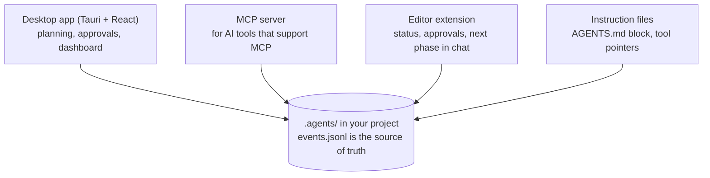

# OmniOrchestrator

<p align="center">
  
</p>

<p align="center">
  <strong>An open-source, local-first tool that keeps AI-assisted software work disciplined, continuous and honest, across the AI tools you already use.</strong>
</p>

<p align="center">
  <a href="https://github.com/Vinay7766/omni-orchestrator/actions/workflows/ci.yml"></a>
  <a href="https://opensource.org/licenses/Apache-2.0"></a>
</p>

> **Status: v0.1 (Foundation), for private testers.** It works end to end, but it is early. Read
> [What works today](#what-works-today) and [Known limits](#known-limits) before relying on it.

---

## What it is for

People who build with AI tools run into three problems:

1. **Switching tools means starting over.** Each tool keeps its own chat; the next one knows nothing.
2. **Agents skip steps.** Long sessions drift, skip the plan and mark work done without proof.
3. **You cannot tell what was decided and why.** The record is scattered across chats.

OmniOrchestrator gives each project **one memory** that every tool reads and writes (a `.agents/`
folder in the project), runs the work **phase by phase**, and lets **only you** approve each phase.

- **Disciplined:** idea review → research → PRD → architecture and tasks → build → review → an
  optional security pass → release → handover. Each phase ends with your review; a task needs a
  design note before code, and evidence for each skill it used before it counts as done.
- **Continuous:** any tool, any vendor, picks up where the last one stopped, from the project memory.
- **Honest:** no made-up data in the app; failures show the real error; test results are only
  accepted with the command run and its output.

All project data stays on your computer. The only network calls go to the AI provider you set up
(your own key, or a local model).

## How it fits together



- **Desktop app:** start from an idea, run the planning phases with your own model, approve or
  send back each phase, choose the tools for the build and hand it to them.
- **MCP server:** serves the current phase, its skills and the project memory to any AI tool that
  supports MCP, and refuses to let an agent approve anything.
- **Editor extension:** shows the phase in the status bar; approve or request changes from the
  editor; start the next phase in a fresh chat.
- **Project memory:** plain Markdown and JSON in `.agents/`; an append-only event log, a snapshot
  rebuilt from it, and readable summaries. See [ARCHITECTURE.md](ARCHITECTURE.md).

## What works today

Proven by the end-to-end test in CI (F1) and by a hand run with two real AI tools from different
vendors on Windows (F2, [results](docs/testing/f2-manual-run.md#results-owners-run-2026-11-03)):

- Planning in the app with a real model: idea review, research, PRD and architecture (with a
  stack decision record), each approved by you, then a task list you approve.
- A review summary at every gate: what was handed in, the skills used with their evidence, your
  earlier change requests, and everything recorded since the last gate.
- Handing the build to a tool; a **second tool from another vendor continuing from the memory
  alone**, stating the goal, phase and next task without being told.
- No API key in the memory files, even when a tool reports one in its own name; commits authored
  by you, and the tools told not to add AI attribution.
- Sessions per phase, and starting the next phase in a fresh session.

Added after that hand run, tested in CI but **not yet seen with real tools**:

- **Start from an idea as a conversation** with your model, until it says it has understood; then
  the phases start, each still waiting for your approval.
- **Answer a document's open questions in a conversation**, then "Generate final document".
- **Your own skills**: add, upload (`SKILL.md`), edit or switch off a skill; every tool connected
  through the MCP server gets the same skills.
- **Tools and models first**: choose your tools and the models you use in each; the task list gives
  each task to the tool and model that fit it best, with a reason; "Set up and open all"; steps to
  start in each tool.
- **The next phase in the editor's chat** (VS Code-family editors with the built-in chat; other
  chats get the prompt on the clipboard).
- **Guided help**: if Git or an AI tool is missing, the app offers to guide you, and simple mode
  explains each planning step in plain words.

Not checked by hand yet: live updates between the app and the editor extension (tested in CI).

## Known limits

Read these before you test:

- **Approvals can be forged by a program running as you.** Any program, including an AI tool, can
  write the memory files directly; a hand-written approval is not detected yet (red-team findings
  RT-1 to RT-3). Signed, tamper-evident approvals are planned (task C17). Do not rely on the
  approval record against a tool you do not trust.
- **Installers are not code-signed.** Windows and macOS will warn when you open them.
- **The MCP server runs from a clone of this repository** (`npm install`, `npm run build`); it is not
  bundled with the installer yet. See [docs/mcp-setup.md](docs/mcp-setup.md).
- **The look of the app is unfinished.** A UI/UX overhaul and the full pitch mode are planned.
- Planning asks the model for long answers; a model with a small output limit may refuse.
- Skills: some third-party skills' licenses and credits are still being verified (before v1.0); each
  skill shows its author, source and license, see `skills/catalog.json` and
  [skills/THIRD_PARTY_LICENSES.md](skills/THIRD_PARTY_LICENSES.md).

The full list of open problems is kept with the project's planning documents.

## Getting started

### Testers: the installer

Download the installer for your system from the release your invitation links to, open it, and
start OmniOrchestrator. The **Setup guide** in the app checks for Git and AI tools and walks you
through what is missing.

### From source

Prerequisites: [Node.js](https://nodejs.org/) 20 or 22, [Rust](https://rustup.rs/) stable, and on
Windows the Visual Studio 2022 Build Tools (C++). On Linux, the
[Tauri prerequisites](https://v2.tauri.app/start/prerequisites/).

```bash
git clone https://github.com/Vinay7766/omni-orchestrator.git
cd omni-orchestrator
npm install
npm run build          # type check, app bundle, and the core, MCP server and extension packages
```

Run the app:

```bash
npm run tauri dev      # on Windows you can also double-click run-dev.bat
```

Then:

1. **Settings:** set your AI provider (your own key, any OpenAI-compatible endpoint, or a local
   model). Keys are kept in your system's credential store, never in plain files.
2. **Start from an idea:** talk your idea through, name the project, start the phases.
3. **After the architecture is approved:** choose your tools and models, approve the task list, and
   hand the build to your tools. To connect a tool by hand, see [docs/mcp-setup.md](docs/mcp-setup.md).

The editor extension is not published yet. To try it from source:
`code --extensionDevelopmentPath="<this folder>/packages/extension" "<your project folder>"`.

### Tests

```bash
npm test                                          # app, core, MCP server and extension (Vitest)
cargo test --manifest-path src-tauri/Cargo.toml   # Rust commands
npm run ci:check                                  # CI's steps for your OS in a clean checkout
```

CI runs every suite on Windows, macOS and Linux.

## Privacy and security

- **Local-first.** Projects stay in your folders; app settings are in `%APPDATA%\AgentOrchestrator`
  (Windows) or `~/.config/AgentOrchestrator` (macOS, Linux). API keys are in the operating
  system's credential store.
- **No telemetry.** Nothing is sent anywhere except to the AI provider you configure, with the
  project text you ask it to work on.
- **Secrets are removed** from everything written to project memory (common key and token
  formats).
- **Only you approve phases.** No agent tool can approve, skip or reorder a phase (but see the
  forged-approval limit above).
- The threat model and the red-team results are in [docs/threat-model.md](docs/threat-model.md) and
  [docs/security/](docs/security/). To report a vulnerability, open a private security advisory on
  GitHub.

## Contributing

See [CONTRIBUTING.md](CONTRIBUTING.md): tests first, Conventional Commits, and the pre-push check
that runs CI's steps.

## License

[Apache License 2.0](LICENSE). Bundled third-party skills keep their own licenses, listed in
[skills/THIRD_PARTY_LICENSES.md](skills/THIRD_PARTY_LICENSES.md).
